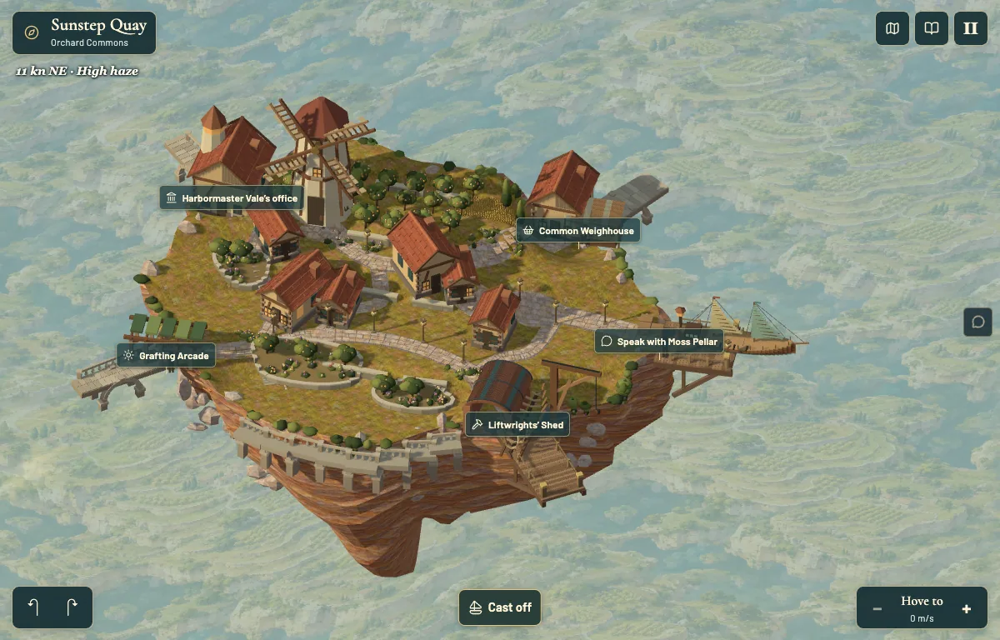

# Skyrates

[Play Skyrates](https://dyelax.github.io/skyrates/)



Take the helm of the Wayfarer, a wooden schooner that rides a glowing lift keel beneath translucent solar sails. Your first commission is to restore the Skyway Beacon. The glassworkers have a replacement lens ready, and someone still has to pay them.

## At the quay

Point at a building or a person to see who is there. Visit the market to trade, talk to the porter for a lead, or find Harbormaster Vale in the green doorway. Press **H** to reveal place names. Board the schooner to inspect the hold, hull, and crew.

Open the sky chart with **M** or the compass. Select an island for passage time, recorded prices, and sailing orders. The captain’s log opens with **J**. Decisions, cargo, and completed encounters save automatically in this browser. Sound and fullscreen are available from the small options control at the quay.

## In a fight

On your first departure from Sunstep, the Harbor Watch runs a chalk-round exercise. Dodge a marked shot, fire your single port cannon, then grapple the watch cutter and watch your crew cross the rail. The exercise saves at each lesson. You can skip it or practice again at a shipyard.

| Order | Control |
| --- | --- |
| Turn | A / D or left / right arrows. Click open sky to steer toward it. |
| Change throttle | W / S or up / down arrows |
| Fire a single cannon | 1–4, click its station, or click the raider to fire an available gun |
| Port or starboard broadside | Q / E |
| Set an intercept for boarding | B |
| Break away | R |
| Pause | P |

Each cannon refit adds a gun until all four stations are filled. A side with two fitted guns gains a broadside order. Each cannon reloads separately. Turning brings a fresh battery to bear. Contact brings the crews together, and crew size, experience, and hull condition influence the outcome. Captains can also slip past a raider before engaging.

## Run locally

Use Node.js 22.12 or newer.

```sh
npm ci
npm run dev
```

`npm test` runs the economy, save, progression, and combat regression tests. `npm run build` type-checks the game and builds the static site into `dist/`. `npm run preview` serves that build locally.

The TypeScript game simulation is independent of the interface. Port definitions and chapter tuning live in [the game data](src/data.ts). Phaser handles the real-time encounters, and a lightweight WebGL effect adds atmospheric light to the illustrated quays. [Artwork and production prompts](docs/artwork.md) · [Bundled third-party notices](public/licenses)

The public game is served from the root of the `gh-pages` branch. Publish the contents of a tested `dist/` build to that branch with a `.nojekyll` file. The `main` branch contains the source and editable game data.

[Design research and first-voyage playtests](docs/design/merchant-and-pirate-games.md)
